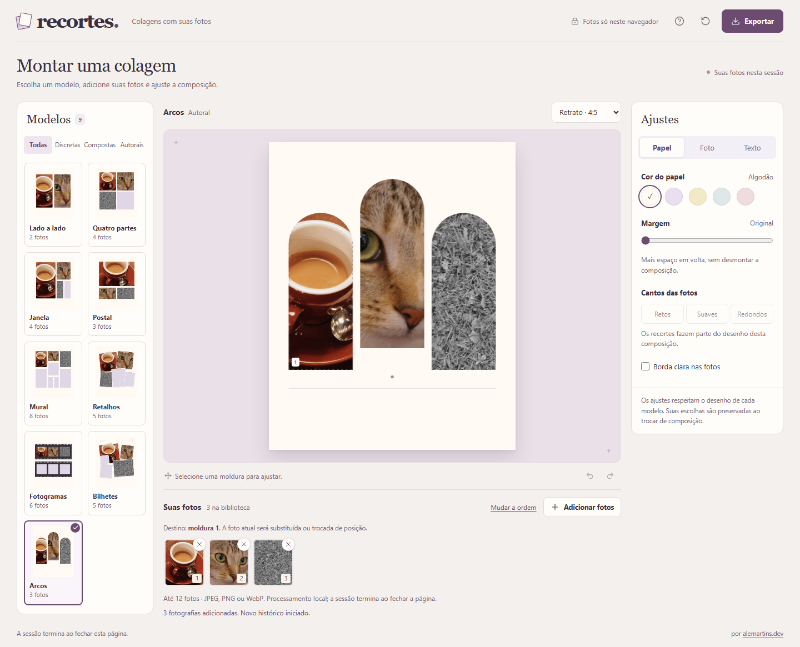

# recortes.

Um jeito de montar colagens com suas fotos, direto no navegador. Escolha um modelo, ajuste o enquadramento, personalize os detalhes e baixe o resultado em PNG, JPEG ou PDF.

A ideia é simples: ter boas composições como ponto de partida, sem precisar montar tudo do zero ou aprender a usar um editor cheio de ferramentas.



*Captura da aplicação com fotografias de demonstração. [Créditos e fontes das imagens](docs/fotografias-demonstrativas.md).*

## Na bancada

- **Nove modelos de colagem**, dos mais discretos aos mais elaborados.
- **Quatro formatos:** retrato, quadrado, paisagem e A4.
- **Até 12 fotografias**, em JPEG, PNG ou WebP.
- **Enquadramento e zoom**, com ajustes por mouse, toque ou controles.
- **Personalização** de papel, margens, cantos, bordas, legendas e datas, conforme o modelo.
- **Desfazer e refazer** alterações, sem precisar recomeçar a composição.
- **Exportação em PNG, JPEG ou PDF**, com opções de alta resolução e tamanho para compartilhamento.

As miniaturas dos modelos acompanham as fotografias escolhidas, então dá para experimentar diferentes composições antes de decidir qual usar.

A aplicação começa com fotos demonstrativas. Ao adicionar suas próprias imagens, os exemplos são substituídos.

## Executar localmente

Você precisa do **Node.js 24** e do npm.

```bash
npm ci
npm run dev
```

A aplicação ficará disponível em [http://localhost:5173](http://localhost:5173).

Para testar o build de produção:

```bash
npm run build
npm run preview
```

Não é necessário configurar variáveis de ambiente, banco de dados ou serviços externos.

## Por dentro

O recortes. foi desenvolvido com **React 19, TypeScript, Vite e Tailwind CSS 4**. A interface também utiliza componentes baseados em Radix/shadcn e ícones do Lucide.

As colagens são desenhadas com a **Canvas 2D API**. Cada modelo possui uma definição própria de geometria, molduras e elementos gráficos. Um motor compartilhado utiliza essas definições para gerar a prévia, as miniaturas e os arquivos exportados.

Durante a edição, o navegador trabalha com versões reduzidas das fotografias para manter a interface responsiva. Na exportação, utiliza os arquivos originais, processando e liberando as imagens conforme necessário.

O processamento mais pesado pode acontecer em um **Web Worker**, evitando bloquear a interface. Quando os recursos necessários não estão disponíveis, a aplicação utiliza o mesmo motor na thread principal.

Os PDFs são gerados com **pdf-lib**. Para os testes, utilizo **Vitest, Testing Library e Playwright**.

Mais detalhes sobre a organização do código, os testes e os comandos disponíveis estão na [documentação de desenvolvimento](docs/desenvolvimento.md).

## Privacidade e limitações

**Suas fotografias ficam no navegador.** O recortes. não possui backend, contas de usuário, uploads remotos ou telemetria das imagens.

As colagens também não são salvas automaticamente. A sessão existe apenas enquanto a página permanece aberta: **recarregar ou fechar a página descarta as fotografias importadas e os ajustes realizados**.

Os limites atuais são:

- Até 12 fotografias por sessão.
- Até 15 MiB por arquivo e 80 MiB no conjunto.
- Imagens de até 32 megapixels e 16.000 pixels por lado.
- Suporte a JPEG, PNG e WebP. HEIC/HEIF ainda não é aceito.

O PDF é gerado com a composição rasterizada, incluindo os textos. Para impressão em folha A4, a aplicação oferece a opção de exportação nas dimensões correspondentes.

Também é possível continuar editando e exportando sem conexão depois que os recursos necessários estiverem carregados na aba atual. Isso não significa que a aplicação possa ser reaberta offline.

## Autoria e licenças

**recortes.** por [alemartins.dev](https://alemartins.dev.br/).

O código e a identidade visual não possuem uma licença de reutilização definida. As bibliotecas utilizadas mantêm suas respectivas licenças, documentadas em [THIRD-PARTY-NOTICES.md](THIRD-PARTY-NOTICES.md).

As fotografias demonstrativas possuem créditos e condições de uso próprios, disponíveis em [Fotografias demonstrativas](docs/fotografias-demonstrativas.md). O conjunto também inclui um estudo cromático original, gerado especificamente para o projeto. O uso de material da NASA não implica endosso ao recortes.